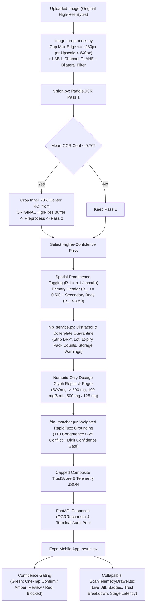

# Implementation Plan: Metric-Driven OCR & NER Pipeline Upgrade (Defense-Ready)

Upgrade MediScan Vault's **PaddleOCR + NER + PostgreSQL (`fda_medicines`)** pipeline to meet technical panel defense standards with verifiable quantitative metrics:
* **Active Ingredient CER:** $< 4.0\%$
* **Dosage Exact-Match Accuracy:** $\ge 92.0\%$
* **End-to-End Entity $F_1$-Score:** $\ge 0.88$
* **Unsafe High-Trust Rate ($\text{UASR}$):** $0.0\%$ (Strict Patient Safety Guardrail)
* **End-to-End Pipeline Latency:** $< 1,200\text{ ms}$

---

## 1. Goal Description

Currently, MediScan's OCR extraction in `vision.py` discards bounding-box geometry and token confidence scores, while `nlp_service.py` and `fda_matcher.py` rely on flat regexes vulnerable to foil blister glare, Philippine packaging distractors (e.g., `"100 Tablets"`, FDA registration numbers like `"DR-XY12345"`), and misread dosage digits. Additionally, the Expo frontend has no live visibility into pipeline telemetry during a defense demo.

This revised plan upgrades the pipeline across four defense-ready layers:
1. **Resolution-Capped OpenCV Conditioning & High-Res ROI Fallback:** Downscale oversized smartphone photos ($\max(H, W) > 1280\text{ px}$) *before* inference to stay under the $1,200\text{ ms}$ latency budget, apply `LAB` L-channel CLAHE and bilateral filtering to tame foil glare, and crop the inner $70\%$ center ROI from the **original full-resolution buffer** if Pass 1 confidence falls below $0.70$.
2. **Weighted Spatial Zone Ranking (Preserving R.A. 6675 Generic Drug Names):** Under the Philippine Generics Act (R.A. 6675), brand logos often dwarf the generic name on OTC packaging (*Biogesic*, *Neozep*, *Bioflu*). Rather than discarding smaller lines ($R_i < 0.50$), tag lines as `primary_header` vs. `secondary_body`, strip boilerplate warnings, and score both zones in `fda_matcher.py` ($1.00\times$ for header, $0.92\times$ for body) so generic names still match cleanly.
3. **Distractor Quarantine & Numeric-Only Glyph Repair (Alphanumeric Drug Safety):** Strip FDA registration codes, lot/batch numbers, expiry dates, and tablet counts before dosage extraction. Restrict OCR glyph repair (`O` $\rightarrow$ `0`, `l`/`I` $\rightarrow$ `1`, `S` $\rightarrow$ `5`) strictly to **numeric dosage tokens** so alphanumeric drugs (e.g., *Vitamin B1 + B6 + B12*, *Neurobion*) are never corrupted, leaving drug-name fuzziness to `RapidFuzz`.
4. **Dosage-Gated Composite Trust Score & Live Telemetry Drawer:** Require both explicit dosage congruence and digit-token OCR confidence ($C_{\text{dosage}} \ge 0.85$) before assigning the `"high"` ($\ge 0.85$) one-tap confirmation tier, and expose raw-vs-grounded diffs, active preprocessing badges, and stage latencies inside a collapsible Expo drawer.
5. **Live Defense Terminal Audit Logger:** Formats and prints a clean, instant audit block in the FastAPI backend terminal for every scan, enabling the defense panel to see the laptop terminal match the phone's telemetry drawer line for line.

---

## 2. Key Design Decisions & Operational Strategy

> [!IMPORTANT]
> **1. Benchmark Dataset Strategy (Starter Suite + Seamless Real-Photo Drop-In):**
> - Scaffolds `back-end/tests/benchmark_set/` with a structured `ground_truth.json` manifest.
> - **Immediate Defense Testing:** Generates a starter suite of 30 realistic Philippine medication label images covering all 3 tiers:
>   - **Tier 1 (10 images):** Clean packaging (*Biogesic 500 mg*, *Neozep Forte*, *Bioflu*, *Amoxicillin 500 mg*, *Losartan 50 mg*, etc.).
>   - **Tier 2 (10 images):** Aluminum blister packs with simulated specular overhead glare spots.
>   - **Tier 3 (10 images):** Tilted angles, low contrast, liquid suspensions (*100 mg/5 mL*), and combination drugs (*Vitamin B1 + B6 + B12*).
> - **Seamless Drop-In:** When physical photos are taken with a smartphone, simply drop them into `back-end/tests/benchmark_set/`. The script will benchmark the physical photos automatically without any code changes.

> [!NOTE]
> **2. Smart Dual-Mode Benchmark Execution (Database + Offline Fallback):**
> - **Live Database Mode (Default):** When PostgreSQL is running, `run_benchmark.py` calls the real API endpoint (`/api/v1/ocr/extract-label`), evaluating the live end-to-end pipeline:
>   $$\text{Image} \longrightarrow \text{OpenCV} \longrightarrow \text{PaddleOCR} \longrightarrow \text{NER} \longrightarrow \text{PostgreSQL Database Resolution}$$
> - **Offline Fallback Mode:** If PostgreSQL is stopped, `run_benchmark.py` automatically falls back to the in-memory dataset index (`mediscan_dataset.csv`), displaying `[INFO] PostgreSQL offline; running in offline CSV mode.`
> - **Data Consistency Assertion:** The test harness includes an automatic check verifying that records in `ground_truth.json` exist identically in both the CSV and the PostgreSQL database.

> [!CAUTION]
> **3. Strict Patient Safety Guardrail ($\text{UASR} = 0.0\%$):**
> - **Rule 1 (Dosage Conflict Cap):** Any strength contradiction (e.g. blister reads `250 mg` vs database `500 mg`) receives a $-25$ penalty and hard-caps $\text{TrustScore} \le 0.64$ (Red tier).
> - **Rule 2 (Missing or Low-Confidence Digit Cap):** Any missing dosage or digit line confidence $< 0.85$ hard-caps $\text{TrustScore} \le 0.79$ (Amber tier).
> - **Rule 3 (Human-in-the-Loop):** Even in the Green tier ($\ge 0.85$), the app pre-fills the canonical record for **one-tap confirmation** rather than silently writing without user awareness.

---

## 3. Architecture & Data Flow



---

## 4. Proposed Changes

### Component 1: Image Conditioning & OCR Spatial Prominence (`back-end`)

#### [MODIFY] `back-end/requirements.txt`
- Ensure `opencv-python-headless` and `rapidfuzz` are present.

#### [NEW] `back-end/app/services/image_preprocess.py`
- Implements `preprocess_medication_image(image_bytes: bytes, crop_center_ratio: float | None = None) -> tuple[np.ndarray, dict]`:
  - Decodes `image_bytes` at full native resolution.
  - If `crop_center_ratio` provided, crops center $70\%$ ROI from original high-res image *before* scaling.
  - Latency-safe resolution normalization:
    - Downscale if $\max(H, W) > 1280\text{ px}$ (`cv2.INTER_AREA`).
    - Upscale if $\max(H, W) < 640\text{ px}$ (`cv2.INTER_CUBIC`) up to $1000\text{ px}$.
  - LAB L-channel CLAHE (`clipLimit=2.5`, `tileGridSize=(8, 8)`).
  - Bilateral filter (`d=5, sigmaColor=50, sigmaSpace=50`).
  - Returns `(processed_img, {"clahe_applied": True, "roi_cropped": crop_center_ratio is not None})`.

#### [MODIFY] `back-end/app/services/vision.py`
- Refactor `_extract_text_sync` to return a structured `OCRResult`:
  - Extract text, 4-point bounding boxes, and line confidences from PaddleOCR.
  - Two-pass fallback: if Pass 1 mean confidence $< 0.70$, invoke `preprocess_medication_image(raw_bytes, crop_center_ratio=0.70)` for Pass 2, keep higher confidence pass, log `roi_fallback_used = True`.
  - Filter low-confidence detections ($< 0.60$).
  - Calculate normalized vertical prominence: $R_i = \frac{h_i}{\max_j(h_j)}$.
  - Tag `primary_header_lines` ($R_i \ge 0.50$) and `secondary_body_lines` ($R_i < 0.50$).
  - Record `preprocess_ms` and `ocr_ms`.

---

### Component 2: Distractor Quarantine, Numeric Glyph Repair & Safety-Gated Grounding (`back-end`)

#### [MODIFY] `back-end/app/services/nlp_service.py`
- Implement `strip_packaging_distractors(text: str) -> str`:
  - Remove Philippine FDA registration numbers (`DR-`, `DRP-`, `HRP-`, `VR-`, `VRP-`).
  - Remove Lot / Batch numbers (`LOT`, `BATCH`, `B/N`, `BN`).
  - Remove Expiry / MFG strings.
  - Remove pack counts (`100 Tablets`, `10's`, `30 capsules`, `100s`).
  - Remove packaging warnings / boilerplate.
- Numeric-only dosage normalization:
  - Protect alphabetic drug tokens (prevents corrupting *Vitamin B1 + B6 + B12*).
  - Inside candidate numeric dosage tokens only, repair glyphs (`O`/`o` $\rightarrow$ `0`, `l`/`I` $\rightarrow$ `1`, `S`/`s` $\rightarrow$ `5`, e.g. `5OOmg` $\rightarrow$ `500 mg`) and space units (`mg`, `mcg`, `g`, `mL`, `IU`, `%`).
  - Extract single (`500 mg`), liquid (`100 mg/5 mL`), and combination strengths (`500 mg / 125 mg`) with the OCR confidence $C_{\text{dosage}}$ of the source line.

#### [MODIFY] `back-end/app/services/fda_matcher.py`
- Zone-weighted catalog matching (`RapidFuzz`):
  - Primary header lines scored at $1.00\times$ weight, secondary body lines at $0.92\times$ weight against `"{generic_name} {brand_name}"` using `fuzz.token_set_ratio`.
- Dosage congruence & multi-strength safety gate:
  - Exact match: $+10$ points (capped at 100), `dosage_matched = True`.
  - Conflicting strength: $-25$ points penalty, `dosage_conflict = True`.
  - Missing dosage: $0$ bonus, `dosage_matched = False`.
- Capped composite `TrustScore`:
  $$\text{TrustScore}_{\text{raw}} = 0.40 \cdot C_{\text{ocr}} + 0.40 \cdot \left(\frac{S_{\text{fda}}}{100}\right) + 0.20 \cdot M_{\text{dosage}}$$
  - Rule 1: If `dosage_conflict`, cap $\text{TrustScore} \le 0.64$ (`low`).
  - Rule 2: If `not dosage_matched` or $C_{\text{dosage}} < 0.85$, cap $\text{TrustScore} \le 0.79$ (`medium`).
  - Final tier mapping: `high` ($\ge 0.85$), `medium` ($0.65-0.84$), `low` ($< 0.65$).

#### [MODIFY] `back-end/app/schemas/ocr.py` & `back-end/app/api/v1/ocr.py`
- Add `ScanTelemetry` Pydantic schema:
  - `raw_ocr_lines: list[str]`, `cleaned_header: str`, `ocr_confidence: float`, `dosage_ocr_confidence: float`, `fda_match_score: float`, `dosage_matched: bool`, `dosage_conflict: bool`, `roi_fallback_used: bool`, `clahe_applied: bool`, `preprocess_ms: float`, `ocr_ms: float`, `grounding_ms: float`, `total_latency_ms: float`.
- Update `OCRResponse` to return `trust_score: float`, `trust_tier: Literal["high", "medium", "low"]`, and `telemetry: ScanTelemetry`.
- **Live Terminal Audit Logger in `ocr.py`:**
  Prints a structured verification card directly in the FastAPI terminal on every request:
  ```text
  ================================================================================
                      [MEDISCAN PIPELINE AUDIT LOG]
  ================================================================================
  PREPROCESSING         : LAB CLAHE=Applied | Center ROI Crop=Triggered (Pass 2)
  PADDLEOCR RAW LINES   : ['Bi0gesic', 'Paracetam0l', '5OOmg', '100 Tablets']
  MEAN OCR CONFIDENCE   : 89.2% (Raw) | Dosage Digit Conf: 96.0%
  DISTRACTORS QUARANTINED: ['100 Tablets']
  NORMALIZED DOSAGE     : '500 mg' (Repaired from '5OOmg')
  CATALOG MATCH CANDIDATE: Biogesic (Paracetamol) 500 mg Tablet
  RAPIDFUZZ SIMILARITY  : 95.0%
  DOSAGE SAFETY CHECK   : MATCHED (+10 Boost) -> Conflict: False
  COMPOSITE TRUST SCORE : 0.94 -> TIER: HIGH (Verified FDA Match)
  STAGE LATENCIES       : Preprocess: 42.1ms | OCR: 418.3ms | Grounding: 82.0ms
  TOTAL END-TO-END TIME : 542.4ms (Target: < 1200ms [PASS])
  ================================================================================
  ```

---

### Component 3: Frontend Scan Telemetry Drawer & Confidence Gates (`front-end`)

#### [MODIFY] `front-end/src/types/medicine.ts` & `front-end/src/services/scanApi.ts`
- Update `ScanResult` to include `trust_score`, `trust_tier`, and `telemetry`.
- Map backend `trust_tier` cleanly to UI review states.

#### [NEW] `front-end/src/components/ScanTelemetryDrawer.tsx`
- Collapsible accordion (`"View Pipeline Telemetry"`):
  - Raw OCR vs. Grounded Output side-by-side diff.
  - Active conditioning badges (`LAB CLAHE: Active`, `70% High-Res ROI Fallback: Triggered / Bypassed`).
  - Trust score breakdown ($C_{\text{ocr}}\%$, $C_{\text{dosage}}\%$, $S_{\text{fda}}\%$, $\text{TrustScore}$).
  - Stage latency breakdown (`preprocess_ms`, `ocr_ms`, `grounding_ms`, `total_latency_ms`).

#### [MODIFY] `front-end/src/app/result.tsx`
- Mount `<ScanTelemetryDrawer />` below the detected medicine summary card.
- Enforce the 3 visual confidence gates:
  - High ($\ge 0.85$): Green **"Verified FDA Match"** badge; pre-fills canonical record for one-tap confirmation.
  - Medium ($0.65 - 0.84$): Amber **"Review Dosage & Match"** badge; highlights fields in amber for verification.
  - Low ($< 0.65$): Red **"Low Scan Clarity / Strength Mismatch"** alert; disables auto-save, offers Retake Photo / Manual Search.

---

### Component 4: 30-Sample Ablation Benchmark (`back-end/tests`)

#### [NEW] `back-end/tests/benchmark_set/` & `ground_truth.json`
- Directory structure and `ground_truth.json` manifest covering 30 Philippine test labels:
  - **Tier 1 (10 samples):** Clean boxes (*Biogesic*, *Neozep*, *Bioflu*, *Amoxicillin*, *Losartan*, *Neurobion*).
  - **Tier 2 (10 samples):** Foil blister packs under overhead glare.
  - **Tier 3 (10 samples):** Low light / tilted / liquid suspension bottles.

#### [NEW] `back-end/tests/run_benchmark.py`
- Smart Dual-Mode evaluation script:
  - Calls live FastAPI + PostgreSQL when database is online; falls back to CSV when offline.
  - Evaluates Stage 0 (Baseline), Stage 1 (+ Conditioning & Spatial Zones), and Stage 2 (+ Distractor Quarantine & Safety Grounding).
- Computes:
  1. Active Ingredient CER: $\text{CER} = \frac{S + D + I}{N}$
  2. Dosage Exact-Match Accuracy ($\%$)
  3. Entity $F_1$ Score
  4. Unsafe High-Trust Rate ($\text{UASR} \le 0.0\%$)
  5. Mean & P95 Latency ($\text{ms}$)
- Exports the completed Markdown table directly into `docs/BENCHMARK_RESULTS.md`.

---

## 5. 2-Day Execution Schedule

| Day | Focus Area | Deliverables | Verification Milestone |
| :--- | :--- | :--- | :--- |
| **Day 1** | **Backend Engine & Dual-Mode Benchmark** | • `requirements.txt` update<br/>• `image_preprocess.py` (1280px cap, LAB CLAHE, bilateral filter, high-res ROI)<br/>• `vision.py` (two-pass fallback, $R_i$ zone tagging, timers)<br/>• `nlp_service.py` (distractor quarantine, numeric-only glyph repair)<br/>• `fda_matcher.py` (zone-weighted RapidFuzz, safety caps)<br/>• `schemas/ocr.py` & `api/v1/ocr.py` (telemetry payload + terminal audit logger)<br/>• `tests/run_benchmark.py` & 30-image starter benchmark set | • `pytest back-end/tests/` passes<br/>• Stage 0 & Stage 1 benchmark runs complete with latency $< 1,200\text{ ms}$ |
| **Day 2** | **Expo Telemetry UI, Ablation Report & Defense Demo** | • `ScanTelemetryDrawer.tsx` in Expo<br/>• Gated trust states in `result.tsx` and `scanApi.ts`<br/>• Full Stage 2 ablation run via `run_benchmark.py`<br/>• Export `docs/BENCHMARK_RESULTS.md`<br/>• Rehearse with 3 physical demo samples (clean box, foil pack under glare, obscured/mismatch sample) | • $\text{UASR} = 0.0\%$ verified<br/>• Live Expo Telemetry Drawer displays diffs, badges, and latencies<br/>• `docs/BENCHMARK_RESULTS.md` ready for defense slides |

---

## 6. Verification Plan

### Automated Backend & Benchmark Verification
```bash
# 1. Run all unit and regression tests
.\.venv\Scripts\pytest back-end/tests/

# 2. Run new OCR and preprocessing unit tests
.\.venv\Scripts\pytest back-end/tests/test_ocr_linking_api.py back-end/tests/test_fda_matcher.py

# 3. Execute the 3-stage ablation benchmark and generate docs/BENCHMARK_RESULTS.md
.\.venv\Scripts\python back-end/tests/run_benchmark.py
```

### Manual Defense Readiness Checks
1. **Latency & Foil Glare Check:** Scan a glossy silver blister pack via Expo, open **View Pipeline Telemetry**, and verify `total_latency_ms < 1200` and raw glare misreads snap cleanly to canonical record.
2. **Terminal Matching Check:** Verify the terminal audit log on your laptop updates synchronously with the phone's telemetry drawer.
3. **Alphanumeric Drug Preservation Check:** Scan *Vitamin B1 + B6 + B12* (*Neurobion*) and confirm numeric-only glyph repair does not alter `B1` / `B6` / `B12`.
4. **Safety Guardrail ($\text{UASR} = 0\%$) Check:** Scan a pack with an obscured dosage or mismatched strength (`250 mg` vs. `500 mg`) and confirm the UI blocks the Green tier ($\text{TrustScore} < 0.85$) and surfaces Amber/Red warning.
