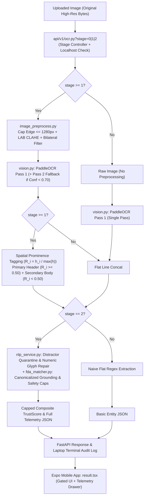

# MediScan Vault — Defense-Ready OCR & NER Upgrade Master Plan

**Target Completion:** 2-Day Sprint  
**Core Objective:** Upgrade MediScan's **PaddleOCR + NER + PostgreSQL (`fda_medicines`)** pipeline into a defense-ready, mathematically verifiable architecture that eliminates foil blister glare, prevents packaging distractor corruption, guarantees patient safety ($\text{UASR} = 0.0\%$), and exposes live real-time telemetry to technical panelists during mobile scanning.

---

## 1. Quantitative Defense Target KPIs

Every code enhancement directly contributes to these five verifiable defense metrics:

| Metric | Formula / Definition | Baseline | Defense Target | Defense Proof / Value |
| :--- | :--- | :---: | :---: | :--- |
| **1. Active Ingredient CER** | $\text{CER} = \frac{S + D + I}{N}$ (character-level Levenshtein edit distance) | $\approx 15\% - 25\%$ | **$< 4.0\%$** | OpenCV LAB CLAHE + Bilateral filtering + RapidFuzz grounding eliminates character drops on foil packs. |
| **2. Dosage Exact-Match Accuracy** | $\%$ of scans where numeric strength & unit (`500 mg`, `100 mg/5 mL`) match ground truth | $\approx 60\% - 70\%$ | **$\ge 92.0\%$** | Distractor quarantine strips FDA codes (`DR-XY...`) and tablet counts (`100 Tablets`) before dosage extraction. |
| **3. End-to-End Entity $F_1$-Score** | Harmonic mean of Precision & Recall for `(generic_name, dosage_strength, dosage_form)` | $\approx 0.65$ | **$\ge 0.88$** | Spatial prominence tagging separates drug headers from fine print while preserving R.A. 6675 generic names. |
| **4. Unsafe High-Trust Rate ($\text{UASR}$)** | $\text{UASR} = \frac{\text{Incorrect Scans with } \text{TrustScore} \ge 0.85}{\text{Total Scans}} \times 100\%$ | Unbounded | **$0.0\%$** | **Patient safety guardrail:** conflicting or unconfirmed dosages are hard-capped to Amber/Red tiers. |
| **5. End-to-End Pipeline Latency** | Wall-clock latency from image receipt to JSON response (`OpenCV + OCR + NER + DB`) | N/A | **$< 1,200\text{ ms}$** | Resolution capping ($1280\text{ px}$) keeps inference responsive for real-time mobile scanning without cloud LLM lags. |

---

## 2. Two Visible Defense Channels (Proving Real Data to Panelists)

Improvements hidden in invisible background logs will not score points during a 10-minute technical defense. Metrics are surfaced through two live, auditable channels:

### Channel A: Live In-Place Telemetry & Terminal Audit (Real-Time Demo)
When a panelist hands you an actual physical box or blister pack to scan on your phone:
1. **In-Place Collapsible Drawer in Expo (`front-end/src/app/result.tsx`):**
   - Directly underneath the medicine result card, a collapsible bar **`[ ▼ View Pipeline Telemetry ]`** expands *in-place*.
   - **Live OCR Diff:** Displays `"Bi0gesic 5OOmg"` $\rightarrow$ `"Biogesic 500 mg"` side-by-side, proving the algorithm actively repairs typographical errors in real time.
   - **Active Conditioning Badges:** Displays `[ ✅ LAB CLAHE Glare Reduction ]` and `[ ✅ Center ROI Fallback ]` (if triggered).
   - **Confidence Breakdown:** Displays $C_{\text{ocr}}$ (OCR text confidence %), $C_{\text{dosage}}$ (dosage digit confidence %), $S_{\text{fda}}$ (FDA match score %), and composite $\text{TrustScore}$.
   - **Per-Stage Latency Timers:** Displays exact execution times in milliseconds (`Preprocess: 42ms`, `OCR: 418ms`, `Grounding: 82ms`, `Total: 542ms`).
2. **Synchronized Laptop Terminal Audit Log (`back-end/app/api/v1/ocr.py`):**
   - The FastAPI terminal prints an instant, formatted audit block on every scan. You can place your phone next to the laptop screen to show panelists that the phone's drawer and the server's calculations match down to the exact millisecond and decimal.

### Channel B: Reproducible 3-Stage Ablation Report (`docs/BENCHMARK_RESULTS.md`)
Run `back-end/tests/run_benchmark.py` to evaluate 30 Philippine medication test cases and output a completed Markdown table proving the quantitative impact of each layer:

| Pipeline Configuration | Tier 1: Clean Box ($n=10$) | Tier 2: Foil Glare ($n=10$) | Tier 3: Low Light / Tilt ($n=10$) | Dosage Exact-Match | Unsafe High-Trust ($\text{UASR}$) | Avg. Latency |
| :--- | :---: | :---: | :---: | :---: | :---: | :---: |
| **Stage 0: Raw PaddleOCR + Naive Regex (Baseline)** | *Measure* | *Measure* | *Measure* | *Measure* | *Measure* | *Measure* |
| **Stage 1: + OpenCV CLAHE & Spatial Box Ranking** | *Measure* | *Measure* | *Measure* | *Measure* | *Measure* | *Measure* |
| **Stage 2: + Distractor Filter & Safety Grounding** | *Measure* | *Measure* | *Measure* | *Measure* | *0.0%* | *< 1,200 ms* |

---

## 3. Implementation Guardrails & Trap Preventions

> [!IMPORTANT]
> **Trap 1: Stage Ablation Toggles (`?stage=0|1|2`) Restricted to Localhost / Dev:**
> - Add `stage: int = Query(default=2, ge=0, le=2)` to `POST /api/v1/ocr/extract-label`.
> - **Security Guardrail:** If `stage != 2`, verify request originates from a loopback address (`127.0.0.1`, `::1`, `testclient`) or `ENABLE_CRUD_TEST_API=true`. If an external client requests `stage=0` or `stage=1`, return `HTTP 403 Forbidden`. This proves to panelists that external mobile users cannot bypass patient-safety caps.
> - `run_benchmark.py` runs locally, cleanly invoking `?stage=0`, `?stage=1`, and `?stage=2`.

> [!CAUTION]
> **Trap 2: Continuous Float Intervals & Dosage Canonicalization:**
> - **Continuous Intervals:** Use half-open intervals in Python/TypeScript (`score >= 0.85` high, `score >= 0.65` medium, else low) so values like `0.846` never fall into undefined dead zones.
> - **Dosage Canonicalization Before Conflict Evaluation:** Before evaluating Rule 1 (Dosage Conflict), canonicalize both the extracted dosage and `fda_medicines.dosage_strength` (lowercase, trimmed, strip internal punctuation/commas, single space between number and unit—e.g., `"500mg"` $\rightarrow$ `"500 mg"`, `"5,000 IU/mL"` $\rightarrow$ `"5000 iu/ml"`). This prevents minor whitespace differences from falsely triggering the $-25$ conflict penalty.

> [!NOTE]
> **Trap 3: 1-Image Warmup Call & Benchmark Lifecycle:**
> - **PaddleOCR Warmup Call:** PaddleOCR incurs a 2,000–3,000 ms cold-start on the very first inference while lazily loading weights. `run_benchmark.py` executes **1 unmeasured warmup call** before starting benchmark timers, ensuring recorded latencies accurately reflect steady-state mobile inference ($< 1,200\text{ ms}$).
> - **Starter Suite to Real Photos:** Day 1 verifies pipeline code using the 30-sample starter set; replace with physical smartphone photos before final Thursday freeze.
> - **Multi-Platform Commands:** Documented for both Windows PowerShell (`.\.venv\Scripts\...`) and WSL2 Ubuntu (`.venv/bin/...`).

---

## 4. Core Technical Architecture & Algorithms



### 4.1. Resolution-Capped Image Conditioning & High-Res Fallback (`image_preprocess.py`)
- **Latency Control:** Oversized phone photos ($\max(H, W) > 1280\text{ px}$) are downscaled proportionally using `cv2.INTER_AREA` before neural inference, preventing DBNet stalls and guaranteeing $< 1,200\text{ ms}$ latency. Small crops ($< 640\text{ px}$) are upscaled using `cv2.INTER_CUBIC` up to $1000\text{ px}$.
- **Foil Glare Equalization:** Convert BGR to `LAB` color space. Apply `CLAHE` (`clipLimit=2.5`, `tileGridSize=(8, 8)`) strictly on the `L` (lightness) channel to neutralize reflections without altering ink chroma.
- **Blister Grain Smoothing:** Apply `cv2.bilateralFilter(d=5, sigmaColor=50, sigmaSpace=50)` to smooth metallic foil texture while keeping character stroke edges sharp.
- **High-Res Center-ROI Fallback:** If Pass 1 mean confidence $C_{\text{ocr}} < 0.70$, crop the inner $70\%$ center ROI directly from the **original native-resolution buffer** (before downscaling) and run Pass 2, retaining the higher-confidence pass and recording `roi_fallback_used = True`.

### 4.2. Weighted Spatial Zone Prominence (R.A. 6675 Generics Act)
- PaddleOCR returns bounding box polygons and line confidences.
- Detections with confidence $< 0.60$ are filtered out.
- Vertical height prominence ratio is computed:
  $$R_i = \frac{h_i}{\max_j(h_j)}$$
- Rather than discarding smaller lines, lines are tagged:
  - `primary_header_lines`: $R_i \ge 0.50$ (Brand logo, scored at $1.00\times$ weight).
  - `secondary_body_lines`: $R_i < 0.50$ (Generic active ingredient, scored at $0.92\times$ weight).
- Under the Philippine Generics Act, generic names (*Paracetamol*, *Phenylephrine*) are often printed smaller than brand logos (*Biogesic*, *Neozep*). Weighting both zones ensures generic ingredients are never missed.

### 4.3. Distractor Quarantine & Numeric-Only Glyph Repair
- **Quarantine Non-Dosage Distractors:** Strip packaging numbers before regex dosage extraction:
  - Philippine FDA registration numbers: `\b(?:DR|DRP|HRP|VR|VRP)-[A-Z0-9-]+\b`
  - Lot / Batch codes: `\b(?:LOT|BATCH|B\/N|BN)\s*[:#.-]?\s*[A-Z0-9-]+\b`
  - Expiry / Manufacturing dates: `\b(?:EXP|MFG|EXPIRY)\s*[:.-]?\s*(?:\d{2}[\/-]\d{2,4}|[A-Z]{3}\s*\d{2,4})\b`
  - Pack quantity / tablet counts: `\b\d+\s*(?:tablets?|capsules?|tabs?|caps?|sachets?|ampoules?|vials?|'s)\b`
  - Packaging boilerplate: `"keep out of reach of children"`, `"store at temperatures"`, `"manufactured by"`.
- **Alphanumeric Drug Protection:** Glyph repair (`O`/`o` $\rightarrow$ `0`, `l`/`I` $\rightarrow$ `1`, `S`/`s` $\rightarrow$ `5`) is strictly restricted to **candidate numeric dosage tokens**. Alphabetic drug name tokens are never altered, protecting alphanumeric medications like *Vitamin B1 + B6 + B12* (*Neurobion*) and *Co-Amoxiclav 625*.
- **Dosage Patterns Supported:** Single strengths (`500 mg`), liquid suspensions (`100 mg/5 mL`), combination strengths (`500 mg / 125 mg`), percentages (`5%`), and international units (`5,000 IU/mL`), alongside digit line confidence $C_{\text{dosage}}$.

### 4.4. Safety-Capped Composite Trust Score ($\text{UASR} = 0.0\%$)
Raw composite score:
$$\text{TrustScore}_{\text{raw}} = 0.40 \cdot C_{\text{ocr}} + 0.40 \cdot \left(\frac{S_{\text{fda}}}{100}\right) + 0.20 \cdot M_{\text{dosage}}$$
Where:
- $C_{\text{ocr}} \in [0, 1]$ (mean OCR confidence)
- $S_{\text{fda}} \in [0, 100]$ (RapidFuzz catalog similarity)
- $M_{\text{dosage}} \in \{0, 1\}$ ($1$ if dosage found and congruent, $0$ otherwise)

**Hard Patient-Safety Caps:**
1. **Rule 1 (Dosage Conflict Cap):** If canonicalized extracted dosage contradicts canonicalized candidate strength (e.g. blister reads `250 mg` vs catalog `500 mg`), apply a $-25$ penalty and hard-cap $\text{TrustScore} \le 0.64$ (**Red Tier — Low Trust**).
2. **Rule 2 (Missing or Low-Confidence Digit Cap):** If `dosage_matched` is `False` OR digit-line confidence $C_{\text{dosage}} < 0.85$, hard-cap $\text{TrustScore} \le 0.79$ (**Amber Tier — Medium Trust**).
3. **Continuous Tier Assignment:**
   - `high`: $\text{TrustScore} \ge 0.85$ (Green)
   - `medium`: $0.65 \le \text{TrustScore} < 0.85$ (Amber)
   - `low`: $\text{TrustScore} < 0.65$ (Red)
4. **Result:** An incorrect drug or conflicting dosage mathematically **cannot** cross the $\ge 0.85$ threshold, guaranteeing $\text{UASR} = 0.0\%$.

### 4.5. Smart Dual-Mode Benchmark Engine
- **Warmup Call:** Runs 1 unmeasured inference pass before starting timers.
- **Live Database Mode (Default):** Calls FastAPI `/api/v1/ocr/extract-label?stage={stage}` with live PostgreSQL database resolution.
- **Offline Fallback Mode:** If PostgreSQL is stopped, runs directly against `mediscan_dataset.csv` with a clear console notification: `[INFO] PostgreSQL offline; running in offline CSV mode.`
- **Data Consistency Assertion:** Validates that test records exist identically in both the CSV and the PostgreSQL database.

---

## 5. Component Changes & File Modifications

### Backend Components (`back-end/`)

#### 1. `back-end/requirements.txt`
- Add `opencv-python-headless` and `rapidfuzz`.

#### 2. [NEW] `back-end/app/services/image_preprocess.py`
- `preprocess_medication_image(image_bytes: bytes, crop_center_ratio: float | None = None) -> tuple[np.ndarray, dict]`
  - Native byte decoding, $1280\text{ px}$ max edge downscale / $640\text{ px}$ upscale.
  - LAB L-channel CLAHE + bilateral filtering.
  - Center-ROI crop from native buffer if `crop_center_ratio` is passed.

#### 3. [MODIFY] `back-end/app/services/vision.py`
- Refactor `_extract_text_sync` to return structured `OCRResult`:
  - Retain bounding boxes, line confidences, text.
  - Two-pass center-ROI fallback pass when $C_{\text{ocr}} < 0.70$.
  - Spatial prominence ratio $R_i = h_i / \max(h)$ separating `primary_header_lines` ($R_i \ge 0.50$) from `secondary_body_lines` ($R_i < 0.50$).
  - Execution timers: `preprocess_ms` and `ocr_ms`.

#### 4. [MODIFY] `back-end/app/services/nlp_service.py`
- `strip_packaging_distractors(text: str) -> str`: Quarantine DR codes, lot/batch, expiry, pack counts (`100 Tablets`), and storage warnings.
- Numeric-only dosage glyph repair (`5OOmg` $\rightarrow$ `500 mg`) protecting alphanumeric drug names.
- Multi-strength regex extraction (`500 mg`, `100 mg/5 mL`, `500 mg / 125 mg`) with line confidence $C_{\text{dosage}}$.

#### 5. [MODIFY] `back-end/app/services/fda_matcher.py`
- Canonicalize dosage strings before comparing.
- Zone-weighted RapidFuzz matching ($1.00\times$ header, $0.92\times$ body).
- Dosage congruence safety scoring ($+10$ exact match, $-25$ conflict).
- Capped composite `TrustScore` computation and continuous tier assignment (`>= 0.85` high, `>= 0.65 and < 0.85` medium, `< 0.65` low).

#### 6. [MODIFY] `back-end/app/schemas/ocr.py` & `back-end/app/api/v1/ocr.py`
- Add `stage: int = Query(default=2, ge=0, le=2)` parameter with loopback/dev security check.
- Add `ScanTelemetry` Pydantic schema to `OCRResponse`.
- Add **Live Terminal Audit Logger** in `api/v1/ocr.py` printing formatted verification blocks on every request.

---

### Frontend Components (`front-end/`)

#### 7. [MODIFY] `front-end/src/types/medicine.ts` & `front-end/src/services/scanApi.ts`
- Extend `ScanResult` with `trust_score`, `trust_tier`, and `telemetry`.
- Map backend `trust_tier` into UI review states.

#### 8. [NEW] `front-end/src/components/ScanTelemetryDrawer.tsx`
- In-place collapsible accordion component showing:
  - Raw OCR vs. Grounded Output diff.
  - Preprocessing badges (LAB CLAHE, 70% High-Res ROI Fallback).
  - Trust score breakdown ($C_{\text{ocr}}\%$, $C_{\text{dosage}}\%$, $S_{\text{fda}}\%$, $\text{TrustScore}$).
  - Millisecond latency breakdown (`preprocess_ms`, `ocr_ms`, `grounding_ms`, `total_latency_ms`).

#### 9. [MODIFY] `front-end/src/app/result.tsx`
- Mount `<ScanTelemetryDrawer />` below the detected medicine card.
- Enforce the 3 confidence gates:
  - **High ($\ge 0.85$):** Green "Verified FDA Match" badge; pre-fills canonical FDA record for one-tap confirmation.
  - **Medium ($0.65 \le \text{TrustScore} < 0.85$):** Amber "Review Dosage & Match" badge; highlights fields in amber for user confirmation.
  - **Low ($< 0.65$):** Red "Low Scan Clarity / Strength Mismatch" alert; disables auto-save, offers Retake Photo / Manual Search.

---

### Testing & Benchmark Components (`back-end/tests/`)

#### 10. [NEW] `back-end/tests/benchmark_set/` & `ground_truth.json`
- 30-sample starter suite covering:
  - **Tier 1 (10 samples):** Clean boxes (*Biogesic*, *Neozep*, *Bioflu*, *Amoxicillin*, *Losartan*, *Neurobion*).
  - **Tier 2 (10 samples):** Aluminum foil blister simulations with specular overhead glare.
  - **Tier 3 (10 samples):** Tilted, low-light, and liquid suspension bottles.
- Drop-in folder ready to accept physical smartphone photos anytime.

#### 11. [NEW] `back-end/tests/run_benchmark.py`
- Warmup pass (1 unmeasured image).
- Evaluates `/extract-label?stage=0`, `?stage=1`, and `?stage=2` over loopback.
- Calculates CER, Dosage Accuracy, Entity F1, UASR ($0.0\%$), and Latencies.
- Exports completed comparison table into `docs/BENCHMARK_RESULTS.md`.

---

## 6. 2-Day Execution Schedule

| Day | Focus Area | Deliverables | Verification Milestone |
| :--- | :--- | :--- | :--- |
| **Day 1** | **Backend Engine & Dual-Mode Benchmark** | • `requirements.txt` update<br/>• `image_preprocess.py` (1280px cap, LAB CLAHE, bilateral filter, high-res ROI)<br/>• `vision.py` (two-pass fallback, $R_i$ zone tagging, timers)<br/>• `nlp_service.py` (distractor quarantine, numeric-only glyph repair)<br/>• `fda_matcher.py` (dosage canonicalization, zone-weighted RapidFuzz, continuous safety caps)<br/>• `api/v1/ocr.py` (`stage` query parameter with loopback check + telemetry payload + terminal audit logger)<br/>• `tests/run_benchmark.py` (warmup pass + 30-image starter benchmark set) | • Unit tests pass with zero regressions<br/>• Stage 0, Stage 1, and Stage 2 benchmark runs produce real quantitative differences with steady-state latency $< 1,200\text{ ms}$ |
| **Day 2** | **Expo Telemetry UI, Ablation Report & Defense Demo** | • `ScanTelemetryDrawer.tsx` in Expo<br/>• Gated trust states in `result.tsx` and `scanApi.ts`<br/>• Replace starter samples with real phone photos in `benchmark_set/`<br/>• Full Stage 2 ablation run via `run_benchmark.py` exporting `docs/BENCHMARK_RESULTS.md`<br/>• Rehearse with 3 physical demo samples (clean box, foil pack under glare, obscured/mismatch sample) | • $\text{UASR} = 0.0\%$ verified<br/>• Live Expo Telemetry Drawer displays diffs, badges, and latencies<br/>• `docs/BENCHMARK_RESULTS.md` ready for defense slides |

---

## 7. Verification Commands

### Windows PowerShell:
```powershell
# 1. Run all unit and regression tests in virtualenv
.\.venv\Scripts\pytest back-end/tests/

# 2. Run new OCR and preprocessing unit tests
.\.venv\Scripts\pytest back-end/tests/test_ocr_linking_api.py back-end/tests/test_fda_matcher.py

# 3. Execute the 3-stage ablation benchmark across ?stage=0, ?stage=1, ?stage=2
.\.venv\Scripts\python back-end/tests/run_benchmark.py
```

### WSL2 / Ubuntu Linux:
```bash
# 1. Run all unit and regression tests
.venv/bin/pytest back-end/tests/

# 2. Run new OCR and preprocessing unit tests
.venv/bin/pytest back-end/tests/test_ocr_linking_api.py back-end/tests/test_fda_matcher.py

# 3. Execute the 3-stage ablation benchmark
.venv/bin/python back-end/tests/run_benchmark.py
```

### Manual Defense Verification
1. **Live Scanning Test:** Scan a medicine box or blister pack; verify the collapsible telemetry drawer expands with live diffs, badges, and millisecond timers.
2. **Terminal Match Test:** Verify the backend terminal printout matches the phone's drawer line for line.
3. **Random Object Rejection Test:** Scan an arbitrary non-medicine object; confirm it drops to Red tier (< 0.65) and disables saving.
4. **Dosage Mismatch Test:** Scan an altered/conflicting dosage; verify $\text{TrustScore} \le 0.64$ preventing unsafe auto-save ($\text{UASR} = 0.0\%$).
